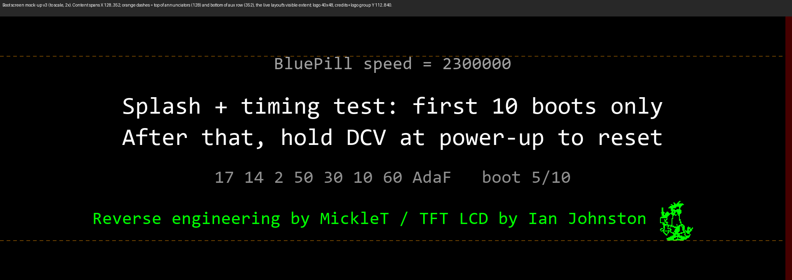

# Boot diagnostics and the splash screen

## What changed, in one paragraph

In Ian's firmware the BluePill speed test ran at every power-up, and the splash screen (credit line plus the TFT timing
numbers) was drawn **inside the live loop**, on top of the live display, for the first few seconds. In this fork both
run **once, on their own boot screen, before the live display starts**, and **only for the first 10 boots**. After that
the board goes straight to the live display. Holding DCV at power-up starts the count again.

**The splash was moved to optimise the live display for normal use.** With the splash drawn in the live loop, the screen
had to be shared between diagnostics and measurements: the grey timing numbers overlapped the (taller) annunciator row for
the first seconds, and the live rows had to leave room for text that only matters on the first boots. Moving it to its own
screen frees the whole panel for the live rows (see [LAYOUT.md](LAYOUT.md)) and takes the splash code out of the loop.
Nothing is lost: the same information is still shown, and can be brought back on demand.

## What you see

*(To-scale mock-up drawn from the constants in the code, `tools/boot_screen_mockup.py`; the real screen uses the panel's built-in fonts.)*

For boots 1 to 10 the TFT shows this for about 9 seconds (the speed test, then a 4 s boot screen), then the live display starts.
Everything is centred and kept inside the vertical band the live display uses (X 128, the top of the annunciator row, to X 352,
the bottom of the aux row), so it is as visible as the live display is:

| Row (top to bottom) | Colour | Font | Text |
| --- | --- | --- | --- |
| speed result | grey | 24-dot | `BluePill speed = N` (see below) |
| note 1 | white | 32-dot | `Splash + timing test: first 10 boots only` |
| note 2 | white | 32-dot | `After that, hold DCV at power-up to reset` |
| settings | grey | 24-dot | the seven TFT timing numbers and panel code, then `boot n/10`, e.g. `17 14 2 50 30 10 60 AdaF   boot 3/10` |
| credits | green | 24-dot | `Reverse engineering by MickleT / TFT LCD by Ian Johnston`, with Ian's character (48 px tall, same green) to the right |

The two notes are the largest text on the screen on purpose: they are what a user needs to know, that this screen is not a
fault and how to bring it back.

**The character** is the figure from the front silkscreen of Ian's own PCB (`Hardware/7680-Controller_backside4_V1_2.zip`,
drawn there as filled Gerber regions; it also appears in the banner of ianjohnston.com). `tools/make_logo.py` turns it into a
1-bit bitmap (`Core/Inc/boot_logo.h`, 240 bytes at 48 px) and `DrawBootLogo_LT()` writes it through the LT7680's active window
in one colour. The artwork is Ian's; it is shown on the boot screen only, next to the credit to him. To drop it, remove the
`DrawBootLogo_LT()` call in `DisplayBootScreen()`.

From boot 11 the board reaches the live display about 3.5 s after power-up. Boots 1 to 10 take about 9.2 s.

`BluePill speed` is the same test as before (it counts loop passes in a fixed time to tell a genuine STM32F103 from a slower
clone). The number depends on the optimisation level, so compare like with like: a good board gives about 1.47 to 1.50
million at `-O0` (Ian's Debug build and the first Prebuilt images) and about 2.3 million at `-O2` (the Prebuilt images from 2026-10-17 on).

## How it works

- **The counter lives in the settings page.** The last 1 KB of flash (`0x0800FC00`) holds the TFT timing settings in
  words 0 to 7. Byte offsets 64 to 127 are now boot markers: each boot programs the next unused word (`0xFFFFFFFF`) to
  `0x00000000`, and the count is the number of programmed words.
- **No erase on a normal boot.** Flash bits can only go from 1 to 0 without an erase, so adding a marker is a single word
  write. The page is erased only when a setting changes (timing mode, first-boot defaults) or when the count is reset.
- **Anything that erases the settings page also resets the count.** The timing-adjust mode rewrites the page, so after you
  pick a new timing the boot screens come back for another 10 boots. That is intended: you will want to see the numbers.
- **Resetting on purpose.** Hold the **DCV** key while powering the meter on. This (a) enters the existing TFT timing-adjust
  mode exactly as in Ian's firmware, and (b) rewrites the settings page with the timing values as loaded, which clears the
  markers. You get boot 1 of 10 again; the timing settings themselves are unchanged unless you pick a new preset.
- **Reflashing does not reset it.** The firmware image ends far below the settings page, so programming keeps the markers
  (the same reason your timing numbers survive a reflash). A full chip erase clears the page, and with it the count and the
  timing settings; avoid it.

## Getting the old behaviour back

All of these are compile-time options; none needs a source edit.

| You want | Build with | Notes |
| --- | --- | --- |
| Boot screen on **every** boot | `-DBOOT_DIAG_SHOWS=255` | The counter stops at 16, so the screen then reads `boot 17/255`. |
| Boot screen **never** (speed test also skipped) | `-DBOOT_DIAG_SHOWS=0` | |
| A different number of boots | `-DBOOT_DIAG_SHOWS=3` | Up to 16 is counted exactly. |
| Boot screen shorter or longer | `-DBOOT_SCREEN_MS=2000` | Milliseconds, default 4000. |
| Ian's splash **inside the live loop**, as before | `-DSPLASH_IN_LOOP=1` | Draws over the live display again. Not tested with the current layout: the text sits below the bottom row and may be clipped at the panel edge. |
| Ian's exact firmware | flash `VisualGDB/Debug/R6581_VS_Display.hex` | Or your own backup. |

Example (see [BENCH-TOOLS.md](BENCH-TOOLS.md)): `EXTRA_CFLAGS="-DBOOT_DIAG_SHOWS=255" bash docs/tools/build.sh my-image`.

## Where it is in the code

- `Core/Src/main.c`: `BOOT_DIAG_SHOWS`, `BOOT_SCREEN_MS`, `BootCountRead/Increment/Reset`, and the block just before the
  boot `ClearScreen()` that decides whether to show the boot screen. `RunBluePillSpeedTestOffline()` ends by drawing it.
- `Core/Src/display.c`: `DisplayBootScreen()` (layout constants `BOOT_*_ROW_X` just above it); `DisplaySplash()` returns at once unless `SPLASH_IN_LOOP` is 1.
- `Core/Src/lt7680.c`, `Core/Inc/boot_logo.h`: `DrawBootLogo_LT()` and the bitmap.

## Tested

Over 12 resets on the bench the count stopped at 10 and boot 11 skipped the screen. The settings page was compared word for
word before and after (timing settings untouched). **Not yet tested:** the DCV-held reset path itself, which needs a finger
on the key at power-up. Please report what you see if you try it.
