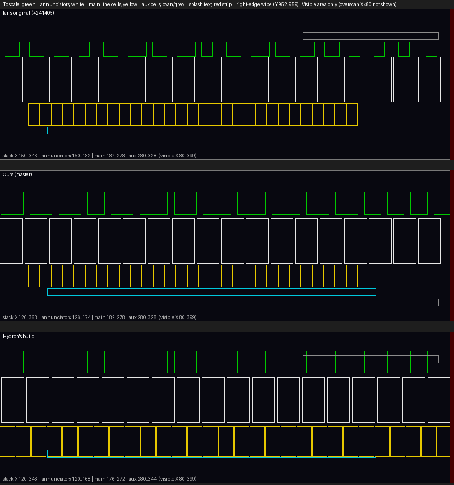
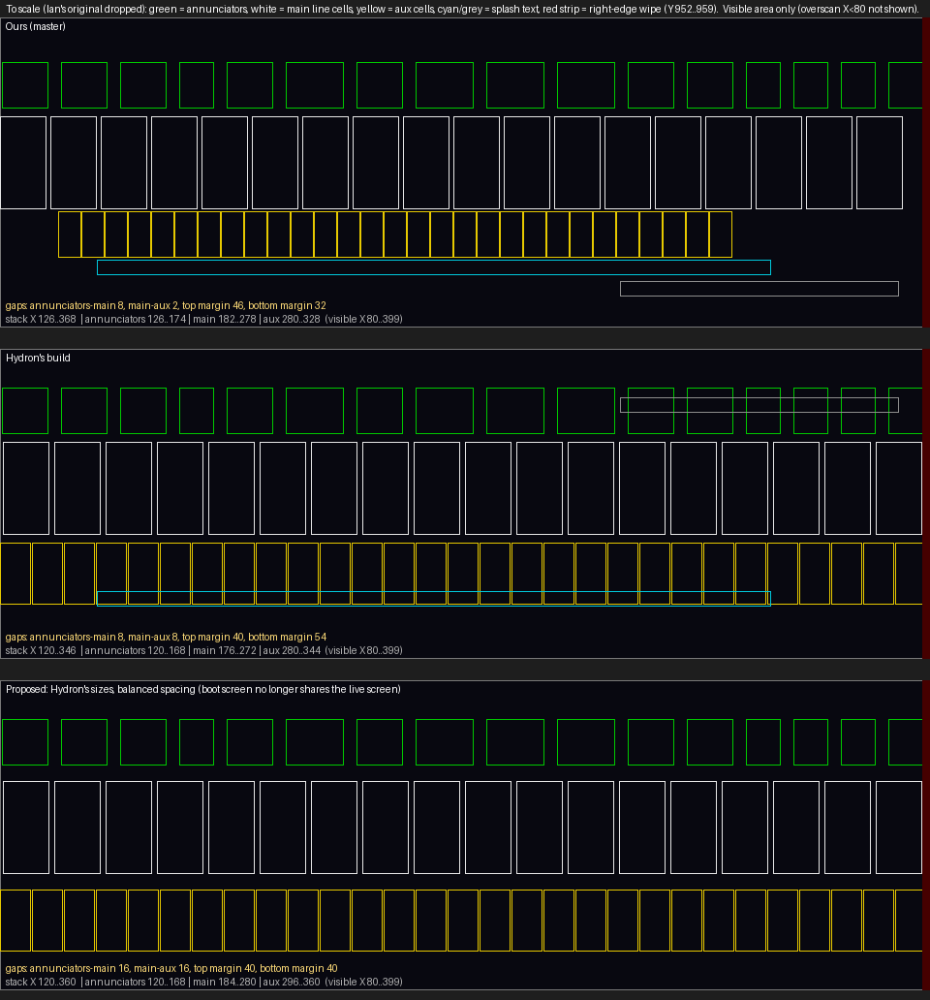

# Display layout

## Geometry

The TFT is 400 x 960 in memory and the text engine rotates 90 degrees, so **X is the vertical position on the screen** and
**Y runs along the line**. The top 80 X-pixels are overscan (hidden); the visible area is X 80 to 399 by Y 0 to 951.
Ian's right-edge wipe (8 black lines at Y 952 to 959) covers the panel's blue vertical edge defect and is kept.

## Current layout

| Row | X (top) | Cell size | Font | Notes |
| --- | --- | --- | --- | --- |
| Annunciators | 128 | 12 x 48 | 24-dot | Labels laid out one after another; ERROR in red; INFO and SLOT blank |
| Main line | 184 | 48 x 96 (pitch 53) | 32-dot, x3 | 18 cells fill the width |
| Aux line | 288 | 32 x 64 (pitch 33) | 32-dot, x2 | Uses the same 16x32 custom-glyph set as the main line |

Gaps are 8 px between rows and about 48 px top and bottom. All positions are macros in `Core/Inc/display.h`
(`Xpos_ANNUNC`, `Xpos_MAIN`, `Xpos_AUX`). Each text line has one entry in a table (`LineFmt` in `Core/Src/render.c`) giving
font size, multiplier, spacing, pitch, position and glyph set, and one routine draws any line containing a custom glyph, so
changing a size is a one-line edit. The row sizes match Hydron's published `display.c` (annunciators 12x48, main 48x96,
aux 32x64); only the positions differ.

## Experiment: taller main line (rejected)

Drawing the main line 4x tall (48 x 128) let the three rows spread evenly with about 20 px gaps. It worked, but:

- it pushed the timed update to 34 to 36 ms against the 35 ms tick at `-O0` (see [TIMING-EXPERIMENTS.md](TIMING-EXPERIMENTS.md)); and
- on one bench panel it produced **lens interference** between the larger main digits and the display's lens.

It was reverted. If your lens differs you might prefer it; the geometry is the last panel of `images/layout_taller_main.png`,
drawn by `tools/layout_diagram.py`.

The boot screen has its own layout, centred and kept inside the same vertical band as the live rows (X 128 to 352), because
nothing else is on screen during boot; see [BOOT-AND-SPLASH.md](BOOT-AND-SPLASH.md).

## Timing-adjust page

The page shown when DCV is held at power-up stays inside the band the meter's window shows: X 128 to about 345 on the
bench (the live rows use 128 to 352). Ian's page started at X 140 and ran to about 324, and the hardware identity rows
added after the rework would have fallen below the window. Every row now uses the largest built-in font, 32 px (16 px
characters plus spacing), which allows 47 characters across the 951 px. Rows (X = top, `TA_X_*` in
`Core/Src/settings.c`), 36 px apart:

| X | Row |
|---|---|
| 128 | `TFT Timing: DCV select/save, pwr cycle to apply` (green) |
| 164 | column names: VBPD VFPD VSPW HBPD HFPD HSPW REFR COG |
| 200 | `Current:` the set in use at power-up (yellow) |
| 236 | `New/Saved:` the set just selected and saved (green; after the first press) |
| 272 | `MCU  CPUID 411FC231 ID 00000000 64KB CYCCNT OK` (cyan) |
| 308 | `Panel  ST7701S FFFFFF  Pwr 9C  LT7680 OK, 1 try` (cyan), ending at 340 |

The three timing rows are 48 and 49 characters with the `New/Saved:` label, so they use 3 px character spacing
instead of 4 to fit the width. The title line replaces Ian's two instruction lines, "Hit DCV to cycle round new TFT LCD
settings" and "Power cycle may be necessary to achieve full effect". Each DCV press selects and saves the next set; a
power cycle applies it fully. The identity rows are described in
[BLUE-PILL-CHIPS.md](BLUE-PILL-CHIPS.md#hardware-identity-on-the-timing-adjust-page).
