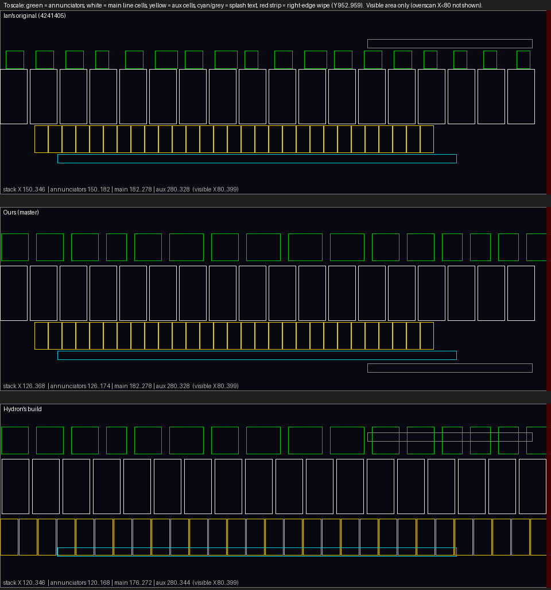
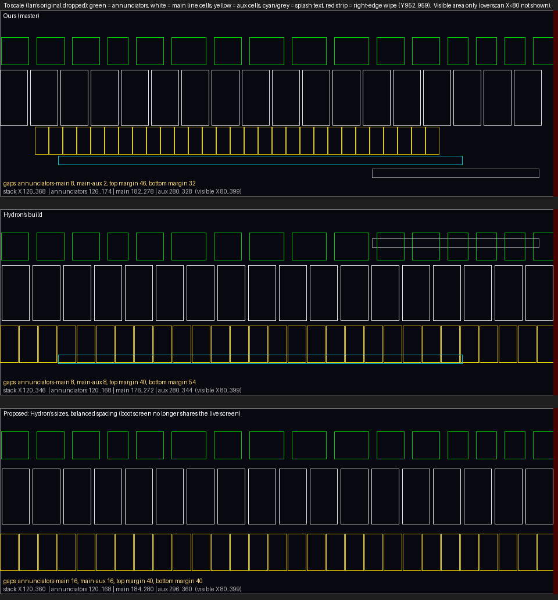

# Display layout

## Geometry

The TFT is 400 x 960 in memory and the text engine rotates 90 degrees, so **X is the vertical position on the screen** and
**Y runs along the line**. The top 80 X-pixels are overscan (hidden); the visible area is X 80 to 399 by Y 0 to 951.
Ian's right-edge wipe (8 black lines at Y 952 to 959) covers the panel's blue vertical edge defect and is kept.

## Current layout

| Row | X (top) | Cell size | Font | Notes |
| --- | --- | --- | --- | --- |
| Annunciators | 128 | 12 x 48 | 24-dot | Labels laid out one after another; ERROR in red; INFO and SLOT blank |
| Main line | 184 | 48 x 96 (pitch 53) | 32-dot, x3 | 18 cells fill the width |
| Aux line | 288 | 32 x 64 (pitch 33) | 32-dot, x2 | Uses the same 16x32 custom-glyph set as the main line |

Gaps are 8 px between rows and about 48 px top and bottom. All positions are macros in `Core/Inc/display.h`
(`Xpos_ANNUNC`, `Xpos_MAIN`, `Xpos_AUX`). Each text line has one entry in a table (`LineFmt` in `Core/Src/display.c`) giving
font size, multiplier, spacing, pitch, position and glyph set, and one routine draws any line containing a custom glyph, so
changing a size is a one-line edit. The row sizes match Hydron's published `display.c` (annunciators 12x48, main 48x96,
aux 32x64); only the positions differ.

## Experiment: taller main line (rejected)

Drawing the main line 4x tall (48 x 128) let the three rows spread evenly with about 20 px gaps. It worked, but:

- it pushed the timed update to 34 to 36 ms against the 35 ms tick at `-O0` (see [TIMING-EXPERIMENTS.md](TIMING-EXPERIMENTS.md)); and
- on one bench panel it produced **lens interference** between the larger main digits and the display's lens.

It was reverted. If your lens differs you might prefer it; the geometry is the last panel of `images/layout_taller_main.png`,
drawn by `tools/layout_diagram.py`.

The boot screen has its own layout, centred and kept inside the same vertical band as the live rows (X 128 to 352), because
nothing else is on screen during boot; see [BOOT-AND-SPLASH.md](BOOT-AND-SPLASH.md).
